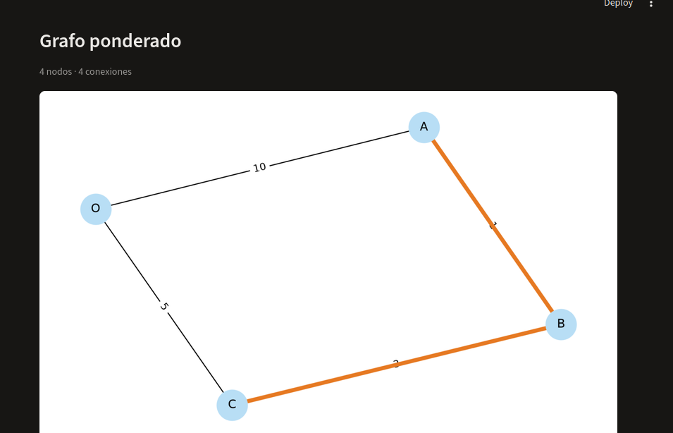
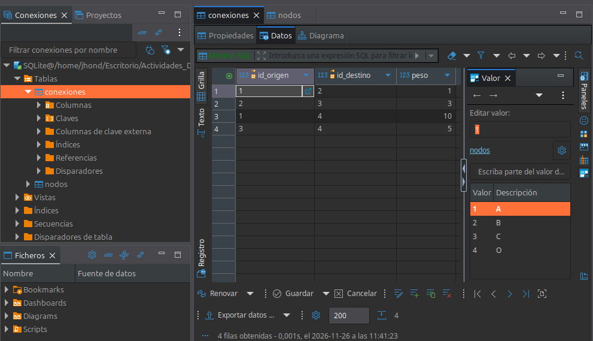
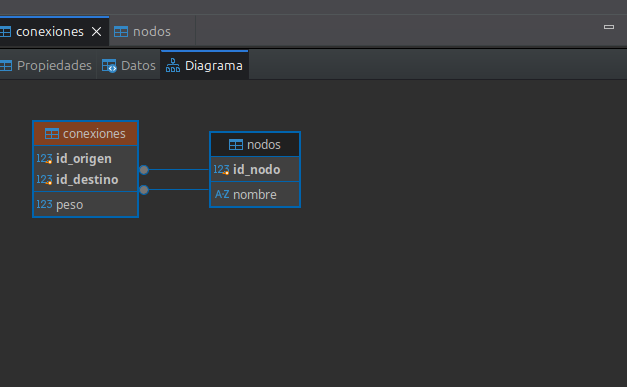
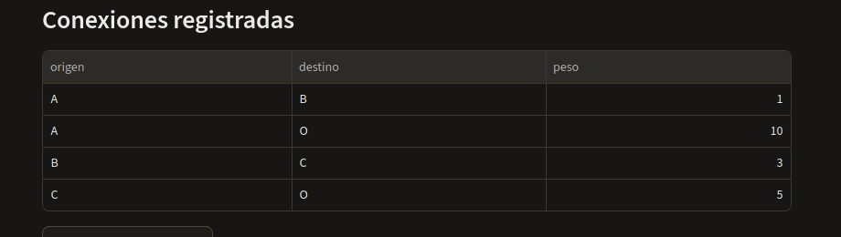

# Find the One Piece

## Descripción del sistema

El programa permite crear nodos, conectarlos y encontrar la ruta más corta entre ellos mediante el algoritmo de Dijkstra. Cuenta con una interfaz gráfica y una base de datos para guardar la información.

### Herramientas utilizadas

- Python 3.12.3
- Streamlit
- NetworkX
- SQLite
- DBeaver

### Comando de ejecución

`streamlit run app.py`

## Conclusión de la materia

En la materia de Programación III aprendí muchas cosas, desde el algoritmo de Dijkstra hasta el uso de Streamlit y el manejo de nodos.

Considero que pudimos haber aprendido aún más, pero debido a que no tuvimos clases de programación durante los primeros semestres, el profesor fue paciente y amable con nosotros, explicándonos todo paso a paso desde el inicio.

Me gustó aprender mediante proyectos prácticos y ver cómo podíamos aplicar los conocimientos adquiridos en clase. Lo que no me gustó fue no haber contado con suficientes conocimientos previos de programación para aprovechar mejor el semestre.

Las dinámicas que más me gustaron fueron esas donde el profesor primero nos decía qué teníamos que hacer con unas diapositivas, nos daba tiempo para pensar nuestras soluciones y después nos ayudaba a encontrar el camino correcto o la solución que él propondría al problema. Eso hacía más dinámica la clase y nada aburrida.

Quizá lo único que no me gustó era la falta de tiempo. Todos somos humanos y hay otras cosas que tenemos que hacer, y comprendo que el profe tiene otras clases en otra universidad, así que llegaba tarde, pero no es molestia. Solo siento que nos faltó tiempo.

## Evidencias de funcionamiento

### Visualización del grafo

Se muestran los nodos y sus conexiones. La ruta más corta calculada mediante el algoritmo de Dijkstra se resalta en color naranja.

### Registros en DBeaver

Se comprueba que las conexiones creadas desde Streamlit se almacenan correctamente en la base de datos SQLite.

### Diagrama relacional

Se observa la relación entre las tablas de nodos y conexiones mediante sus llaves primarias y foráneas.

### Conexiones registradas

La aplicación muestra los nodos de origen, destino y el peso de cada conexión. Estos datos coinciden con los registros de DBeaver.

